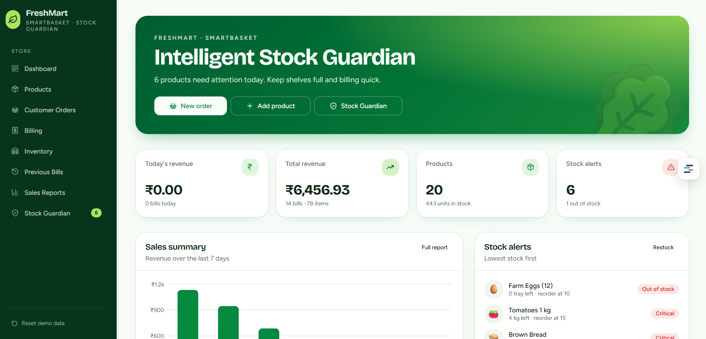
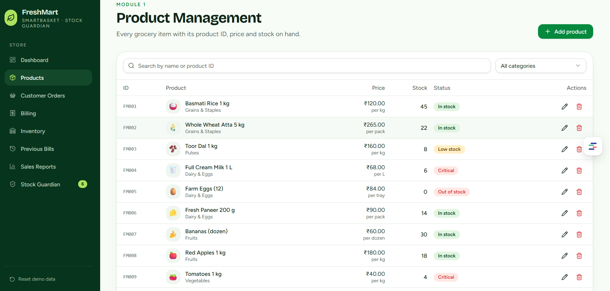
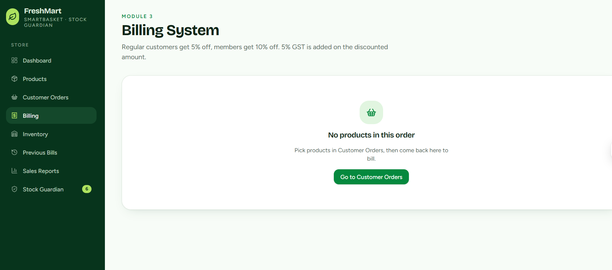

# 🛒 FreshMart – SmartBasket & Intelligent Stock Guardian

### A Smart Grocery Management System

FreshMart is a smart grocery management system designed to simplify grocery shopping, billing, and inventory management. It combines customer-friendly shopping features with intelligent stock monitoring to help store owners manage their businesses efficiently.

## 🌟 Project Overview

Traditional grocery stores often face challenges such as manual billing, inventory mismanagement, stock shortages, and difficulty identifying popular products.

FreshMart addresses these problems through an integrated grocery management solution with intelligent features.

## 🎯 Objectives

- Simplify grocery billing and shopping.
- Maintain accurate product stock information.
- Reduce stock shortages through intelligent recommendations.
- Identify popular products.
- Provide useful business insights.

## ✨ Key Features

### 1. Smart Billing
- Automatic bill generation.
- Product-wise price calculation.
- Regular customer discount: 5%.
- Member discount: 10%.

### 2. Inventory Management
- Maintain product information.
- Monitor available stock.
- Track product quantities.

### 3. Smart Stock Guardian
- Identify products with low stock.
- Recommend products that need restocking.
- Help prevent stock shortages.

### 4. SmartBasket
- Simplify the shopping process.
- Generate purchase summaries.

### 5. Popular Product Predictor
- Identify popular products.
- Help understand customer purchasing patterns.

### 6. Daily Business Insights
- Provide useful sales information.
- Help store owners make better business decisions.

## 💡 Innovation

The main innovation of FreshMart is the **Smart Stock Guardian**.

Instead of simply displaying available stock, the system helps identify products that require restocking. This makes inventory management more intelligent and efficient.

## 🛠️ Technologies Used

- Lovable – Website development.
- GitHub – Source code management.
- Java – Console application development.

## 🌐 Live Website

[Visit FreshMart](https://smartbasket-stock-guardian.lovable.app/)

## 🎓 Project Information

**Project Name:** FreshMart – SmartBasket & Intelligent Stock Guardian

**Domain:** Grocery Management System

## 🚀 Future Enhancements

- AI-based demand forecasting.
- Online payment integration.
- Customer purchase history.
- Automated inventory alerts.
- Advanced sales analytics.

## 👩‍💻 Project Goal

Our goal is to transform traditional grocery management into a smarter, faster, and more efficient system using technology.

---
## 📸 Website Screenshots

### Home Page

### Product Listing

### Smart Stock Guardian
.

### Customer Orders
.

### Billing System
.

### Inventory Mnagement
.

### Previous Bills
.

### Sales Reports
.
**FreshMart – Making Grocery Management Smarter! 🛒**
