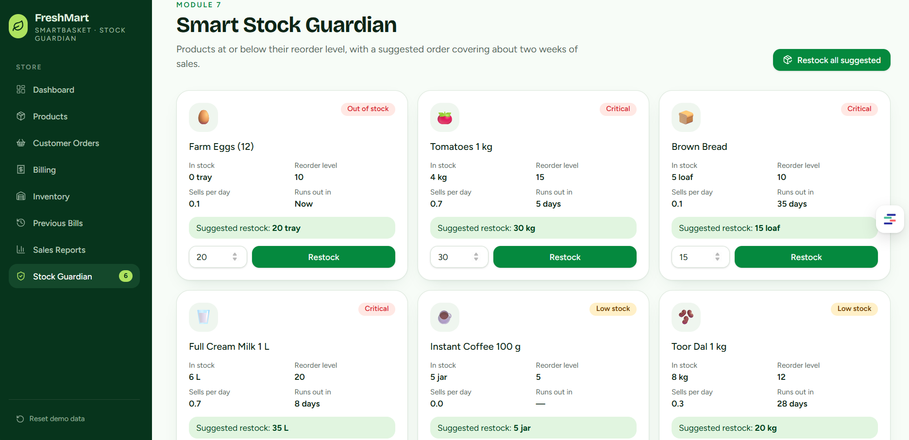
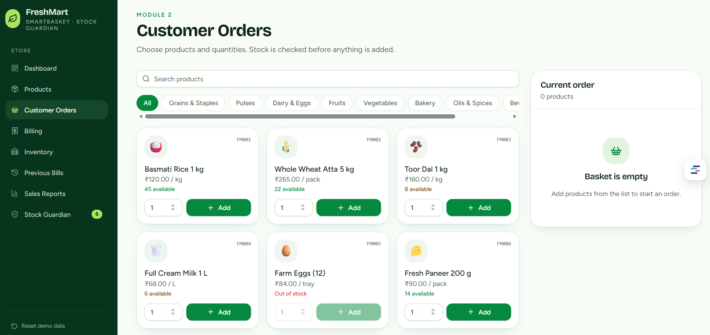
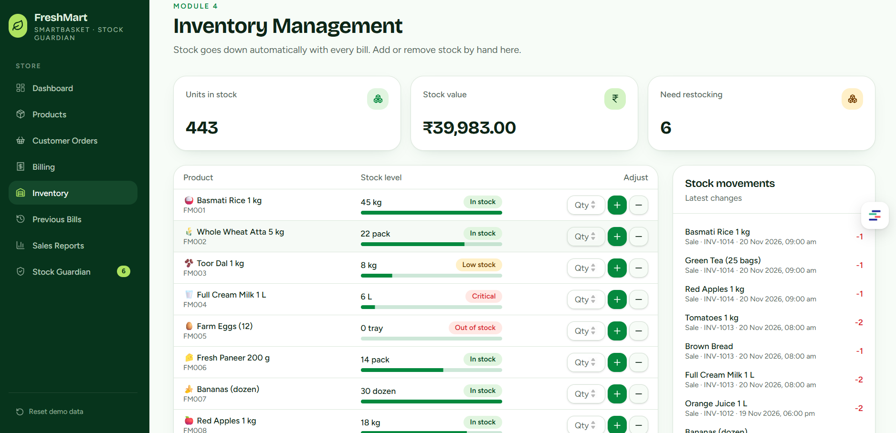
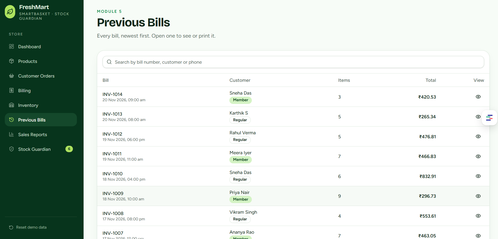
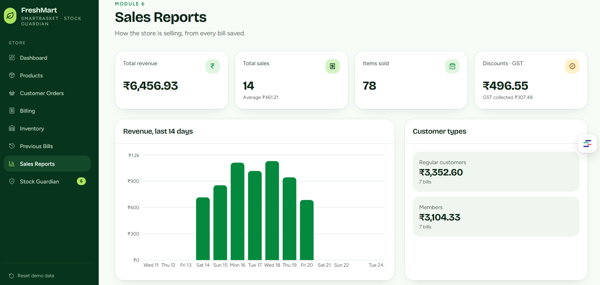

# 🛒 FreshMart – SmartBasket & Intelligent Stock Guardian

### A Smart Grocery Management System

FreshMart is a smart grocery management system designed to simplify grocery shopping, billing, and inventory management. It combines customer-friendly shopping features with intelligent stock monitoring to help store owners manage their businesses efficiently.

### 📌 Problem Statement

Traditional grocery stores often face challenges in managing product inventory, generating bills, tracking customer orders, and identifying products that need restocking.

Manual processes can lead to stock shortages, billing errors, inefficient inventory management, and difficulty understanding sales patterns.

FreshMart aims to address these challenges through a smart grocery management system that combines automated billing, inventory tracking, and intelligent stock recommendations.

## 🌟 Project Overview

Traditional grocery stores often face challenges such as manual billing, inventory mismanagement, stock shortages, and difficulty identifying popular products.

FreshMart addresses these problems through an integrated grocery management solution with intelligent features.

## 🎯 Project Objectives

1. Develop a user-friendly grocery management website.

2. Simplify product selection and billing.

3. Implement customer-based discount management.

4. Improve product inventory monitoring.

5. Identify products that require restocking.

6. Provide sales reports and business insights.

7. Make grocery management faster and more efficient.

### 💡 Project Innovation

The major innovation of FreshMart is Smart Stock Guardian.

Unlike a basic grocery management system, FreshMart focuses on intelligent inventory assistance.

Innovative Features:

Smart Stock Guardian: Helps identify products with low stock and provides restocking recommendations.

SmartBasket: Provides organized shopping and purchase summaries.

Popular Product Predictor: Helps identify popular products based on available sales information.

Daily Business Insights: Helps store owners understand business performance.

Our objective is to move beyond traditional grocery billing and create a smarter grocery management experience.

## ✨ Key Features

### 1. Smart Billing
- Automatic bill generation.
- Product-wise price calculation.
- Regular customer discount: 5%.
- Member discount: 10%.

### 2. Inventory Management
- Maintain product information.
- Monitor available stock.
- Track product quantities.

### 3. Smart Stock Guardian
- Identify products with low stock.
- Recommend products that need restocking.
- Help prevent stock shortages.

### 4. SmartBasket
- Simplify the shopping process.
- Generate purchase summaries.

### 5. Popular Product Predictor
- Identify popular products.
- Help understand customer purchasing patterns.

### 6. Daily Business Insights
- Provide useful sales information.
- Help store owners make better business decisions.

## 💡 Innovation

The main innovation of FreshMart is the **Smart Stock Guardian**.

Instead of simply displaying available stock, the system helps identify products that require restocking. This makes inventory management more intelligent and efficient.

## 🛠️ Technologies Used

### Frontend
- React 19
- TypeScript
- TanStack Start
- TanStack Router

### Styling and UI
- Tailwind CSS 4
- Radix UI
- Lucide React

### Data Visualization and Management
- Recharts
- TanStack React Query
- Zod

### Development Tools
- Lovable AI
- Vite
- GitHub
- ESLint
- Prettier
- Vitest

## 🏗️ Project Architecture

FreshMart follows a modular application structure using React, TypeScript, and TanStack Start.

### Source Code Structure

src/
├── components/       # Reusable UI components
├── hooks/            # Custom React hooks
├── lib/              # Utility functions and shared logic
├── routes/           # Application pages and routes
├── test/             # Testing files
├── routeTree.gen.ts  # Generated route tree
├── router.tsx        # Application routing
├── server.ts         # Server configuration
├── start.ts          # Application startup
└── styles.css        # Global styling

### Main Application Modules

- Smart Billing
- Product Management
- Customer Orders
- SmartBasket
- Inventory Management
- Smart Stock Guardian
- Previous Bills
- Sales Reports

### Application Workflow

1. Users interact with the FreshMart website.
2. The application processes shopping and billing operations.
3. Inventory information is managed through the application.
4. Smart Stock Guardian identifies products that may require restocking.
5. Business reports help store owners understand sales activity.
## 🌐 Live Website

[Visit FreshMart](https://smartbasket-stock-guardian.lovable.app/)

## 🎓 Project Information

**Project Name:** FreshMart – SmartBasket & Intelligent Stock Guardian

**Domain:** Grocery Management System

## 🚀 Future Enhancements

- AI-based demand forecasting.
- Online payment integration.
- Customer purchase history.
- Automated inventory alerts.
- Advanced sales analytics.

## 👩‍💻 Project Goal

Our goal is to transform traditional grocery management into a smarter, faster, and more efficient system using technology.

## 🚀 How to Run the Project

Follow these steps to run FreshMart locally.

### Prerequisites

- Node.js
- npm
- Git

### Installation

**Step 1: Clone the repository**

git clone https://github.com/gunjihemasanjana-18/smartbasket-stock-guardian.git

**Step 2: Navigate to the project folder**

cd smartbasket-stock-guardian

**Step 3: Install dependencies**

npm install

**Step 4: Start the development server**

npm run dev

**Step 5: Open the application**

Open the local URL displayed in your terminal, usually:

http://localhost:3000

The terminal will display the actual address and port used by the development server.
## 📸 Website Screenshots

### Home Page

### Product Listing

### Smart Stock Guardian
.

### Customer Orders
.

### Billing System
.

### Inventory Mnagement
.

### Previous Bills
.

### Sales Reports
.
**FreshMart – Making Grocery Management Smarter! 🛒**
